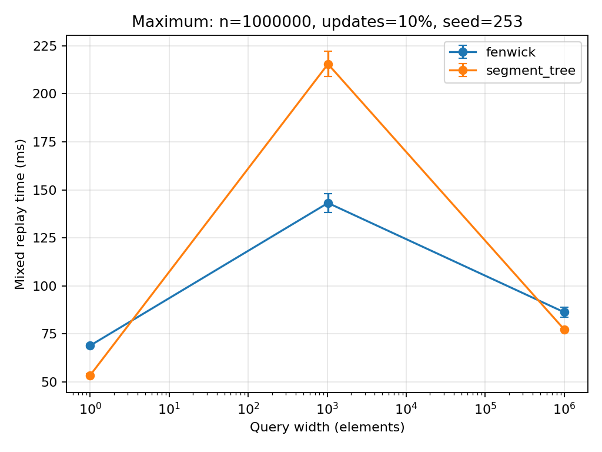
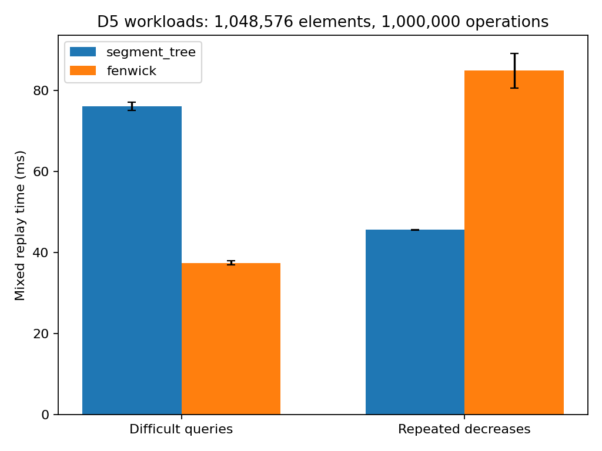
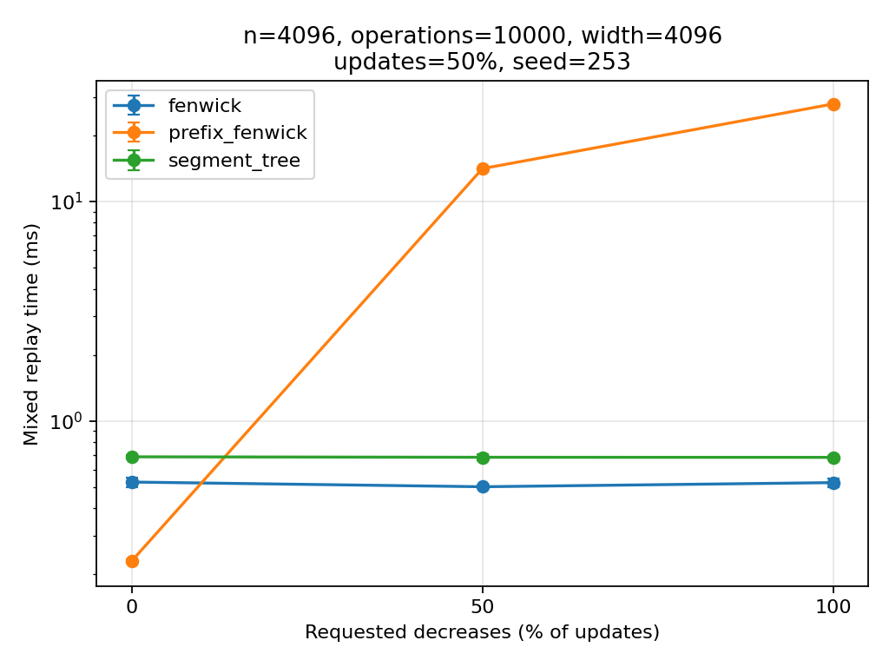
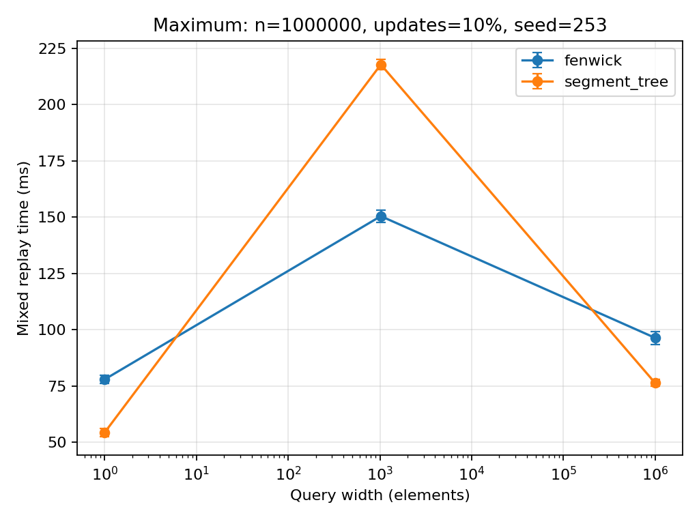
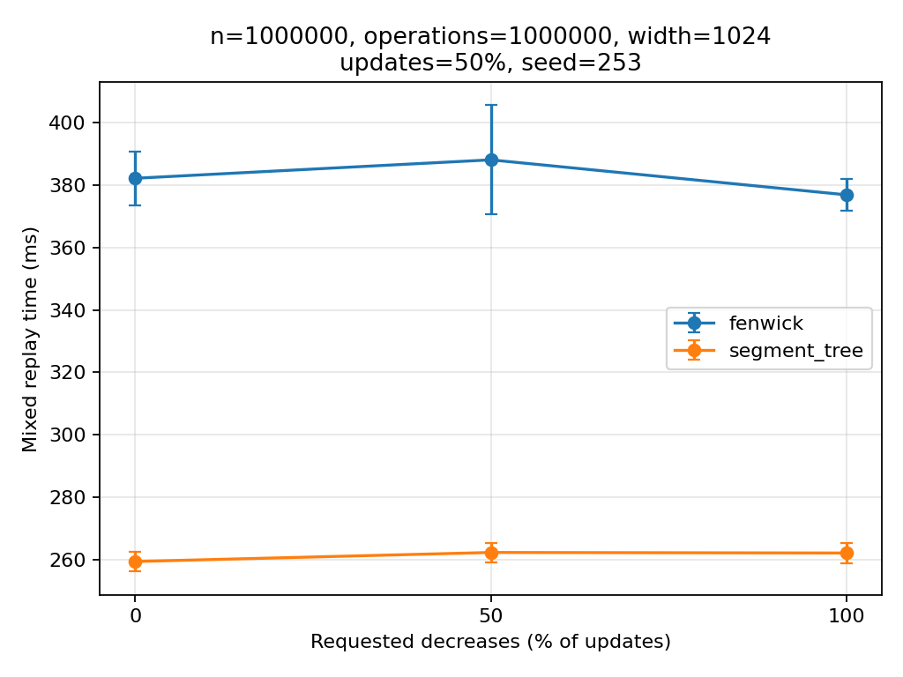
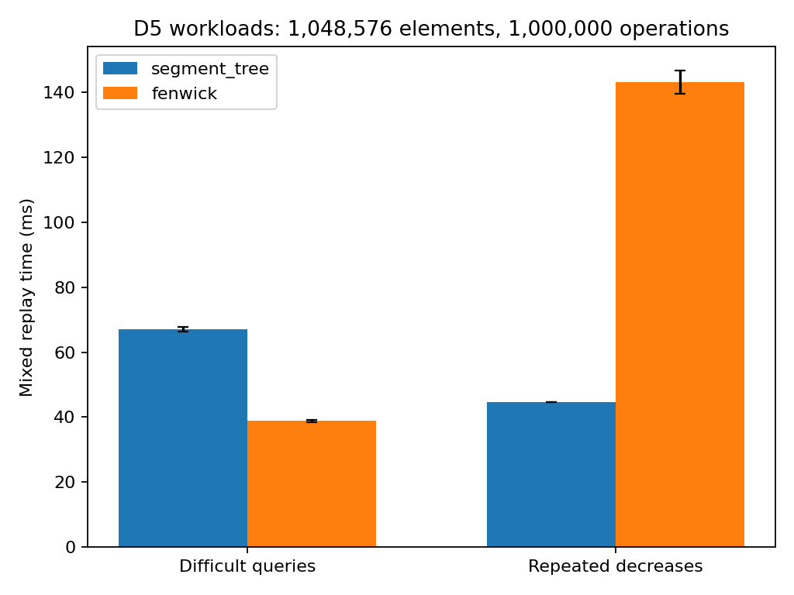
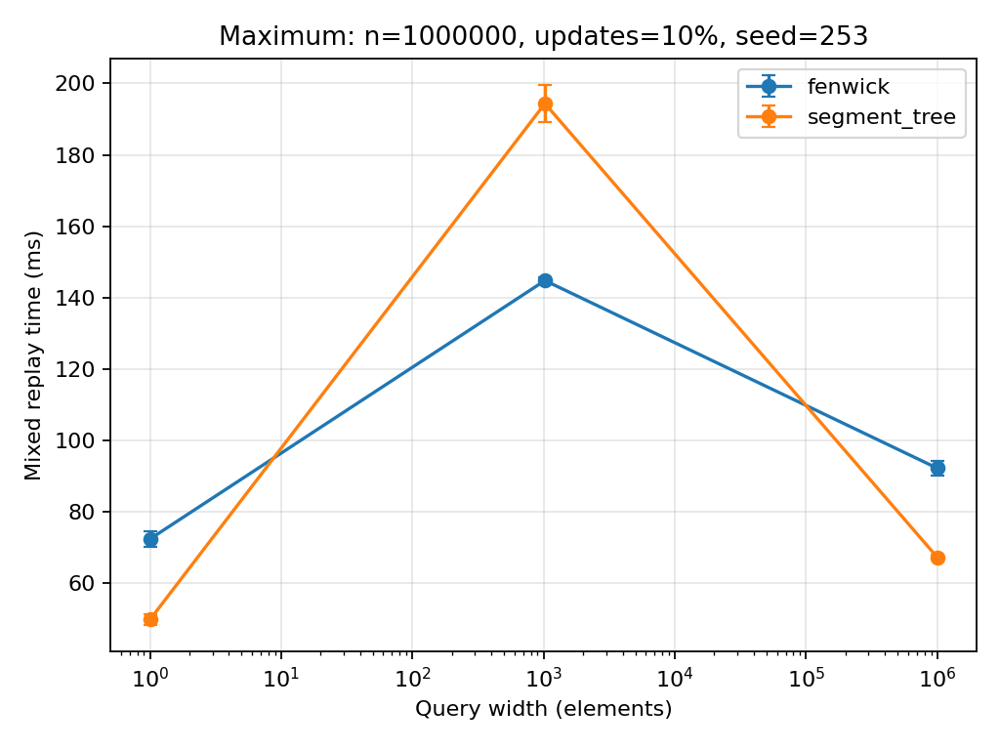
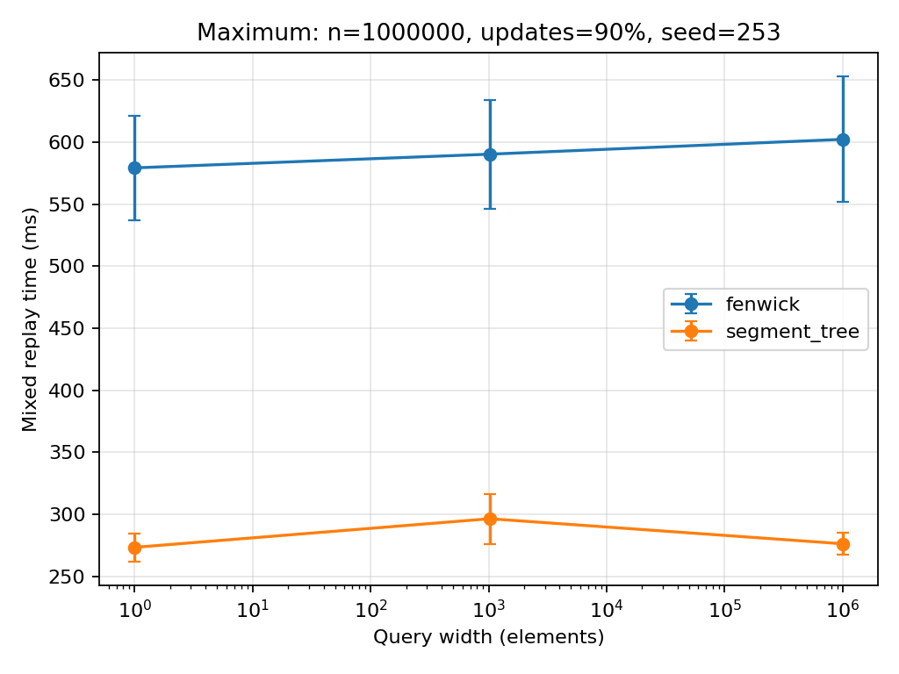
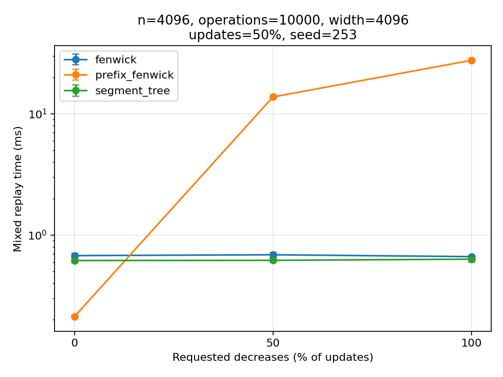
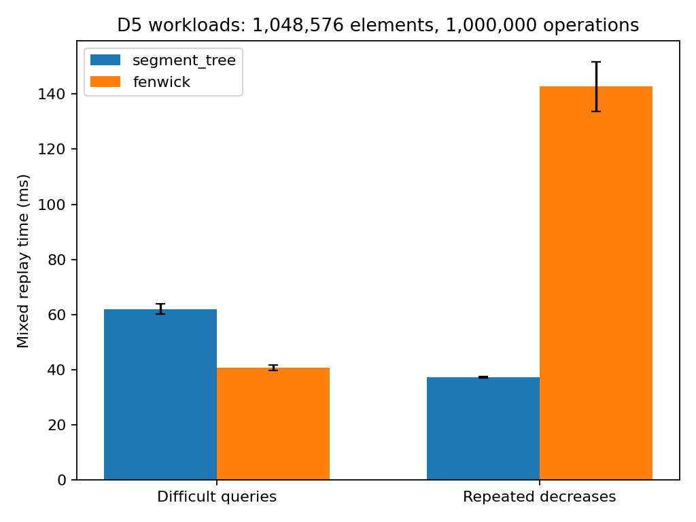

# Results

## 20 November counters-off timing runs

These local reruns use D1 `01da510` and D2 `e925e6f`, with a D6 switch that disables B's counters at compile time. A's counters are also disabled. The data-structure algorithms are unchanged. Counter collection uses a separate build. These revisions are the current remote D1/D2 branch tips checked on 20 November; the team still needs to select the release commit.

Each maximum workload has 1,000,000 values and 1,000,000 operations, seed 253, and five repetitions. Values below are mean replay milliseconds ± sample standard deviation. Construction is measured separately. The dated folder preserves the new data alongside all earlier runs.

| Width | Updates | Segment tree A (ms) | Two-tree Fenwick B (ms) |
| ---: | ---: | ---: | ---: |
| 1 | 10% | 53.41 ± 0.66 | 68.88 ± 0.81 |
| 1024 | 10% | 215.51 ± 6.58 | 143.16 ± 4.87 |
| 1000000 | 10% | 77.32 ± 0.51 | 86.25 ± 2.65 |
| 1024 | 50% | 271.82 ± 17.20 | 376.30 ± 46.82 |
| 1024 | 90% | 341.94 ± 44.03 | 624.30 ± 92.48 |

B was faster for width 1024 at 10% updates, while A was faster in the other cases listed. Some full-scale random and decrease-sweep configurations have large spread. These runs were made on an interactive Windows machine; no background-load or thermal isolation was recorded. The data does not establish why the timings vary. Timing changes from the earlier runs cannot be attributed solely to disabling counters because the runs happened at different times.

The D5 scale workloads use 1,048,576 values and 1,000,000 operations:

| Workload | A (ms) | B (ms) |
| --- | ---: | ---: |
| Difficult queries | 76.12 ± 1.01 | 37.47 ± 0.53 |
| 500,000 decreases + 500,000 queries | 45.59 ± 0.09 | 84.92 ± 4.28 |

The decrease study covers all 27 width/update/decrease configurations. Its separate prefix workload uses n=4096, 10,000 operations and 50% updates:

| Requested decreases among updates | Actual decreases | Prefix replay (ms) |
| ---: | ---: | ---: |
| 0% | 0 | 0.23 ± 0.00 |
| 50% | 2532 | 14.12 ± 0.04 |
| 100% | 5051 | 27.84 ± 0.07 |

The prefix trend agrees with the predicted O(n U_-) rebuild term at fixed n. This fixed-size experiment does not prove the asymptotic bound.

D5 scale checks compare every maximum and count with the deterministic expected answer. Separate counter runs retain D5's expected totals: 39,000,000 B query blocks for the query case; 10,500,000 query blocks, 21,000,000 assignment steps and 11,000,000 lowered blocks for the decrease case. Small random and prefix checks use D4's array oracle. All 44 raw timing files have five repetitions per structure and matching checksums; the scale check logs are saved in the dated folder. Checksums are an agreement check, not a correctness proof.

## Newer cache recordings

The 17 November traces have 1,568 A and 4,892 B samples when filtered by the benchmark thread IDs. One B sample occurs after its recorded process/thread lifetime; the stricter lifetime filter gives 4,891 B samples. The count audit, trace hashes and zero-loss tracerpt summaries are in `results/cache/`. Both counts and their filters are recorded there. The earlier 1,587/6,412 figures below belong to the older recordings.

These newer traces still include preparation, construction and 20 replays. They were recorded before the counters-off change and have different process durations. They do not explain the cause of the replay-time differences, and raw sample counts do not establish a cache-performance ranking. A further comparison would need traces from the same code/settings, repeated recordings and a clearly identified replay interval.

## 17 November run with counters enabled

This run used D1 revision `01da510`, D2 revision `e925e6f` and the D4 oracle. B's counters were enabled during timing while A's were disabled. The 20 November section above contains the counters-off rerun. The older results below use an earlier D1 snapshot.

For one million values and operations, the five-run mean replay times were:

| Width | Updates | Segment tree (ms) | Two-tree Fenwick (ms) |
| ---: | ---: | ---: | ---: |
| 1 | 10% | 54.36 | 77.94 |
| 1024 | 10% | 217.73 | 150.41 |
| 1000000 | 10% | 76.33 | 96.36 |
| 1024 | 50% | 263.41 | 375.78 |
| 1024 | 90% | 307.02 | 581.02 |

As in the earlier runs, B was faster for width 1024 at 10% updates, while A was faster in the other cases above. The measurements do not establish why. Raw runs, standard deviations and plots are in `results/d1-update/`.

At width 1024 and 50% updates, the 0%, 50% and 100% decrease workloads took 259.37, 262.26 and 262.09 ms for A, and 382.22, 388.13 and 376.92 ms for B. These are mixed replay times, not isolated update costs. The full decrease study is in `results/d1-update-decreases/`.

For D5's million-operation query case, A and B averaged 67.01 and 38.79 ms; for the decrease case they averaged 44.63 and 143.31 ms. All operations in both scale cases were checked against their expected answers. D4's 100,000-operation D1 differential test and million-operation D2 test also passed. These results are for the current snapshots, not confirmed final team code.

The WPR cache samples below were collected with the earlier D1 snapshot. They cannot be used as measurements of this rerun; collect new traces after the team confirms its versions.

## Earlier measurements with the original D1 snapshot

These measurements use the earlier D1 snapshot documented in `results/README.md`. They are retained as the first measurement set; the 17 and 20 November runs are documented above.

## Random maximum workload

For each point, both structures processed the same 1,000,000 operations over 1,000,000 elements. Times below are mean mixed replay milliseconds from five runs. Standard deviations and individual runs are in `results/`.

| Width | Updates | Segment tree (ms) | Two-tree Fenwick (ms) |
| ---: | ---: | ---: | ---: |
| 1 | 10% | 49.68 | 72.28 |
| 1024 | 10% | 194.37 | 144.75 |
| 1000000 | 10% | 67.18 | 92.14 |
| 1024 | 50% | 244.93 | 396.37 |
| 1024 | 90% | 296.53 | 590.40 |

For width 1024 at 10% updates, the Fenwick version was faster on this workload. As updates became more common, the segment tree was faster. This is consistent with both having logarithmic operations but different work per operation; the measurements alone do not establish the cause. Width and alignment affect the number of blocks, so a whole-array query need not cost more than a medium-width query.

The D2 constructor scans the blocks it builds. Its total scanned length has an `O(n log n)` upper bound, whereas the Dima-Ceterchi paper describes a linear build. The timings measure this implementation, not a linear-build implementation. A's maximum-only tree is used so its updates do not also recompute GCD. B's counters are always enabled, while A's counters are disabled in timing runs. This difference can affect the comparison and needs attention before making a final claim.

## Varying decreases

The newer generator changes a selected value by one on every update. It chooses whether to increase or decrease according to the requested percentage. At `n=1000000`, width 1024 and 50% updates, the mean mixed replay times in milliseconds were:

| Decreases among updates | Segment tree | Two-tree Fenwick |
| ---: | ---: | ---: |
| 0% | 250.19 | 375.10 |
| 50% | 252.36 | 380.84 |
| 100% | 269.54 | 384.90 |

These are five-run means for seed 253, not isolated per-update times. The corresponding standard deviations and actual update counts are in `results/decrease-sweep/summary.csv`. The A/B comparison remains provisional because of the D1 revision and B's active counters. These cases change values by one; results may differ for larger changes or other value distributions.

For the prefix-only workload at `n=4096`, 10,000 operations and 50% updates, the prefix baseline's mean replay time was 0.21 ms, 13.80 ms and 27.69 ms at 0%, 50% and 100% requested decreases. The actual decrease counts were 0, 2532 and 5051. Since this baseline rebuilds after each decrease, the rise is consistent with the model. Each of the three curves used the same seed and five runs; D4's oracle checked the queries on these cases. The full CSV and sample standard deviations are in `results/decrease-sweep/prefix-summary.csv`.

## D5 workloads

At `n=4096`, the repeated-rebuild workload used 1024 decreases and 1024 queries. The prefix baseline recorded 1024 rebuilds. Its mean replay time was 5.98 ms, versus 0.085 ms for the two-tree Fenwick and 0.127 ms for the segment tree. The separate decrease workload also recorded 1024 prefix rebuilds. These timings cover the specified small deterministic workloads; they are not million-element measurements.

The updated D5 branch also specifies scale cases at `n=1048576`. For one million difficult queries, mean replay time was 61.97 ms for A and 40.71 ms for B. For 500,000 decreases interleaved with 500,000 queries, it was 37.27 ms for A and 142.75 ms for B. These are means of five runs; spread and raw values are in `results/d5-scale/summary.csv` and the timing CSVs.

For the difficult-query case, B recorded 39,000,000 query blocks. For repeated decreases, it recorded 10,500,000 query blocks, 21,000,000 assignment steps and 11,000,000 lowered blocks. These totals match D5's analysis of this implementation. Every query result was checked against the known answer of the corresponding deterministic generator. The prefix baseline was not run at this size. B's counters were enabled during timing, so the timing comparison has the limitation described above.

Random maximum checks and the three D5 generators were checked against D4's oracle at small sizes. Full-scale A/B timing checksums matched, but checksums do not replace the oracle. The GCD tree was also measured at full scale across the same widths and mixes. For width 1, its answers were checked against D4's oracle; wider GCD runs measured only the tree.

In a separate GCD counter run at width 1024 and 50% updates, the tree selected 4,996,370 query blocks and performed 21,055,611 Euclidean remainder steps across the replay. The count excludes construction. Scanning those same query ranges with the array oracle would visit 511,597,568 elements; that figure is calculated from their widths, not a timed oracle run. The counters and definitions are in `results/gcd-counts/` and `bench/README.md`.

## Predictions and observations

The prefix baseline was expected to slow down as decreases forced rebuilds. Its replay time rose from 0.21 ms with no decreases to 27.69 ms with 5,051 decreases, which is consistent with the predicted rebuild cost. This is one fixed-size workload, so it does not by itself establish an asymptotic bound.

The cost model did not predict a fixed winner between A and B. In the random maximum workload at 10% updates, B was faster at width 1024, while A was faster at widths 1 and 1,000,000. This variation is consistent with different block paths and constants, but the timings do not isolate their cause. The array model predicts more work for wider ranges; the GCD oracle was timed only at width 1, so these measurements do not establish that trend for the array.

The GCD measurements count tree blocks and Euclidean remainder steps separately. They do not prove the tighter telescoping bound; its assumptions still need to be confirmed with D3. All comparisons should be repeated with the agreed final implementations and consistent timing instrumentation.

The original WPR recordings produced 1,587 samples for A and 6,412 for B under their recorded filter. The newer recordings and their verified filter counts are documented above and in `results/cache/README.md`. Neither set is an exact cache-miss total or rate; both cover preparation and construction as well as replay.
