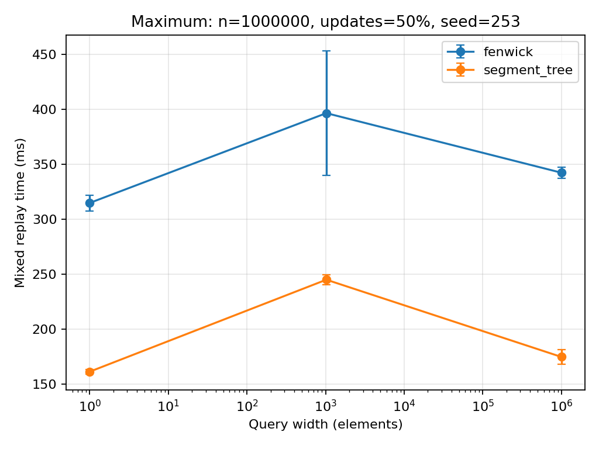

# Results

These are preliminary D6 measurements. They use an earlier D1 snapshot because the current `feature/structA-d1` branch was reset. Confirm D1's final revision and repeat the experiments before submission. The machine, compiler, seeds, branch revisions and raw CSV files are documented in `results/README.md`.

## Random maximum workload

For each point, both structures processed the same 1,000,000 operations over 1,000,000 elements. Times below are mean mixed replay milliseconds from five runs. Standard deviations and individual runs are in `results/`.

| Width | Updates | Segment tree (ms) | Two-tree Fenwick (ms) |
| ---: | ---: | ---: | ---: |
| 1 | 10% | 49.68 | 72.28 |
| 1024 | 10% | 194.37 | 144.75 |
| 1000000 | 10% | 67.18 | 92.14 |
| 1024 | 50% | 244.93 | 396.37 |
| 1024 | 90% | 296.53 | 590.40 |

For width 1024 at 10% updates, the Fenwick version was faster on this workload. As updates became more common, the segment tree was faster. This is consistent with both having logarithmic operations but different work per operation; the measurements alone do not establish the cause. Width and alignment affect the number of blocks, so a whole-array query need not cost more than a medium-width query.

The D2 constructor scans the blocks it builds. Its total scanned length has an `O(n log n)` upper bound, whereas the Dima-Ceterchi paper describes a linear build. The timings measure this implementation, not a linear-build implementation. A's maximum-only tree is used so its updates do not also recompute GCD. B's counters are always enabled, while A's counters are disabled in timing runs. This difference can affect the comparison and needs attention before making a final claim.

## D5 workloads

At `n=4096`, the repeated-rebuild workload used 1024 decreases and 1024 queries. The prefix baseline recorded 1024 rebuilds. Its mean replay time was 5.98 ms, versus 0.085 ms for the two-tree Fenwick and 0.127 ms for the segment tree. The separate decrease workload also recorded 1024 prefix rebuilds. These timings cover the specified small deterministic workloads; they are not million-element measurements.

The updated D5 branch also specifies scale cases at `n=1048576`. For one million difficult queries, mean replay time was 61.97 ms for A and 40.71 ms for B. For 500,000 decreases interleaved with 500,000 queries, it was 37.27 ms for A and 142.75 ms for B. These are means of five runs; spread and raw values are in `results/d5-scale/summary.csv` and the timing CSVs.

For the difficult-query case, B recorded 39,000,000 query blocks. For repeated decreases, it recorded 10,500,000 query blocks, 21,000,000 assignment steps and 11,000,000 lowered blocks. These totals match D5's analysis of this implementation. Every query result was checked against the known answer of the corresponding deterministic generator. The prefix baseline was not run at this size. B's counters were enabled during timing, so the timing comparison has the limitation described above.

Random maximum checks and the three D5 generators were checked against D4's oracle at small sizes. Full-scale A/B timing checksums matched, but checksums do not replace the oracle. The GCD tree was also measured at full scale across the same widths and mixes. For width 1, its answers were checked against D4's oracle; wider GCD runs measured only the tree. No cache profiler results have been collected. Repeat the comparison against the final team code.
